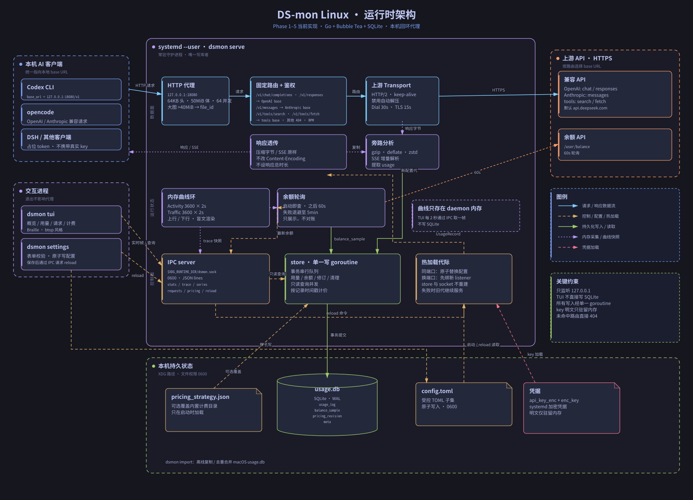

# 架构

## 架构图



可缩放原图是 `docs/architecture.svg`，同目录下的 `architecture.png` 用于不方便显示 SVG 的场景。
实线表示请求/响应与持久化路径，虚线表示控制、配置和内存采集；图中只画当前已经实现的部分。

## 进程模型

```
 Codex / DSH / 其他客户端
        │  HTTP
        ▼
 ┌─────────────────────┐        ┌──────────────────────────┐
 │ dsmon serve         │        │ dsmon tui                │
 │  · 本地代理 :18080  │◄──────►│  · 概览 / 用量 / 请求    │
 │  · 用量采集         │ socket │  · 计费 / 设置入口       │
 │  · 余额轮询         │ JSON   │  · 只读查库（历史）      │
 │  · 计费更新检查     │        └──────────────────────────┘
 │  · 曲线环形缓冲     │        ┌──────────────────────────┐
 └─────────┬───────────┘◄──────►│ dsmon settings           │
           │ SQLite             │  · 表单 / 校验 / 写配置  │
           ▼                    └──────────────────────────┘
   ~/.local/share/dsmon/usage.db
```

- daemon 是唯一写库者；TUI 的历史查询用只读连接（WAL 允许并发读）。
- 曲线数据只存在 daemon 内存里，TUI 每秒通过 socket 取一帧。
- TUI / settings 退出不影响代理；daemon 退出时代理不可用（systemd 负责拉起）。

## 目录职责

| 包 | 职责 |
|---|---|
| `cmd/dsmon` | 子命令分发：serve / tui / settings / status / import |
| `internal/proxy` | 监听、路由、鉴权改写、转发、SSE、采集、曲线打点 |
| `internal/store` | SQLite 打开/迁移/写入/查询、单写者 goroutine |
| `internal/pricing` | 规则解析、峰谷、最长前缀、修订时间轴、更新管道 |
| `internal/balance` | 余额请求、状态码映射、轮询、采样 |
| `internal/tui` | bubbletea 模型、页面、盲文画布 |
| `internal/config` | XDG 路径、TOML、密钥加密、热加载 |

## IPC

- 地址：`$XDG_RUNTIME_DIR/dsmon.sock`，权限 0600。
- 协议：一条连接上多行 JSON；每行一个请求，每行一个响应。字段名小写蛇形。
- 版本：每个响应带 `"v": 1`；不兼容变更时提升。

请求：

```json
{"v":1,"cmd":"stats"}
{"v":1,"cmd":"trace","width":100}
{"v":1,"cmd":"series","range":"today","dimension":"model"}
{"v":1,"cmd":"series","range":"custom","dimension":"client","from":1761926400,"to":1762185600}
{"v":1,"cmd":"requests","limit":50,"offset":0}
{"v":1,"cmd":"pricing"}
{"v":1,"cmd":"reload"}
```

响应：

```json
{"v":1,"ok":true,"data":{...}}
{"v":1,"ok":false,"error":"proxy not running"}
```

`stats` 返回：代理状态/端口、当前余额、24h/7d 余额采样趋势、今日 token/请求/命中率/花费、
最近请求与错误。趋势由 daemon 下采样并缓存 30 秒。
`trace` 返回：活动曲线 20 格、当前画布可见的流量桶（upload/download，daemon 最多保留
3600 个 0.5 秒桶）、两条道的量程、下行/上行速率（已做显示迟滞）、健康状态。
`series` 返回按小时/天分桶、按模型或客户端拆分的请求数、命中/未命中/输出 token 与费用。
`requests` 返回倒序分页行；`pricing` 返回修订数、最近生效时间和来源。
`reload` 让 daemon 重新读取并校验配置：成功返回时新设置已经生效；失败时旧监听/旧轮询继续运行，
错误原样返回给设置页。

`stats` 同时返回当前监听地址和余额低阈值，使端口/阈值热加载后 TUI 立即看到新值。
TUI 的实时帧和历史查询都走 socket；TUI 不直接写库，也不长期持有 SQLite 连接。

## 代理

### 路由

| 路径 | 上游 |
|---|---|
| `/v1/chat/completions`、`/v1/responses` | 配置里的 OpenAI 兼容 base |
| `/v1/messages` | 配置里的 Anthropic base |
| `/v1/tools/search`、`/v1/tools/fetch` | 配置里的 DeepSeek base |
| `GET/HEAD /v1/models`、`/v1/models/{id}` | 按请求协议选择 OpenAI / Anthropic base |
| 其他 | 404，不猜 |

### 鉴权

客户端发占位 token；代理用本地存储的 key 覆盖：

- OpenAI 兼容：`Authorization: Bearer <key>`
- Anthropic：`x-api-key: <key>`，并保留 `anthropic-version`（缺省补 `2023-06-01`）

### 限制与超时

| 项 | 值 | 响应 |
|---|---|---|
| 请求头 | 64KB | 431 |
| 声明正文 | 20MB | 413 |
| 并发连接 | 64 | 503 |
| 请求完整收包 | 120s | 断开 |
| 响应总时长 | 不设上限 | — |

Go 的 `net/http` 原生支持 chunked 请求体，所以不再像 Swift 版那样对 chunked 返回 501；
大小限制仍然生效。

### 压缩与 SSE（源项目踩过的坑）

- 不让 `http.Transport` 自动解压：关闭自动 gzip，客户端要什么就透传什么。
  压缩字节原样转发，`Content-Encoding` / `Content-Length` 保持上游值。
- 用量分析走旁路：转发同时把同一段响应喂给独立解压器，再交给
  `ResponseBodyCollector`。gzip/deflate/zstd 可提取 usage；没有引入 brotli 解码器，
  `br` 只原样透传。
- 如果以后改成解压转发，必须同时删掉这两个头，否则客户端会二次解压
  （`Z_DATA_ERROR: incorrect header check` → undici `terminated` 重试循环）。
- `Content-Type: text/event-stream` 的响应必须逐块 flush；不要让任何中间层缓冲。
- 响应结束按上游的 `Content-Length` / chunked 语义处理，不擅自改成 close-delimited。

### 用量提取

- OpenAI 非流式：`usage.prompt_tokens` / `completion_tokens` / `total_tokens`，
  `prompt_tokens_details.cached_tokens`，`completion_tokens_details.reasoning_tokens`。
- OpenAI SSE：累积每个 chunk 的 usage，最终以带 usage 的那个 chunk 为准；
  同时兼容 `[DONE]` 结束标记。
- Anthropic：`usage.input_tokens` / `output_tokens` / `cache_read_input_tokens` /
  `cache_creation_input_tokens`。
- Search / Fetch：HTTP 200 且 `results` 非空 / `content` 非空，记 `fixed_cost = 0.005`。
- 失败请求也记录（status_code、延迟），但 token 为 0、费用为 0。

写入点只有一个：请求结束时由采集器发到 store 的写队列，避免并发写 SQLite。
模型发现等辅助路由共享鉴权、压缩和转发链路，但不写 `usage_log`，避免污染用量、费用和请求页。

## 数据层

- `internal/store/schema.sql` 与 Mac 版同构，启动时执行 `CREATE TABLE IF NOT EXISTS`。
- `PRAGMA journal_mode=WAL`、`busy_timeout=2000`。
- 保留 180 天：启动时和每 24 小时删除 `timestamp < now - 180d`。
- 去重索引：`(timestamp, model, provider_id, prompt_tokens, completion_tokens)` 唯一。
- 所有写操作进单 goroutine；读连接可以是多个（database/sql 自己管理）。
- 计费修订：每次导入写一条 `pricing_revision`，`usage_log.pricing_revision` 记录这行由哪条修订计价。
- 时间戳按 REAL 保存，保留 Mac 版小数秒精度，避免同一秒内的记录被错误合并。
- `dsmon import` 先把源库及 `-wal` / `-shm` / `-journal` 复制到临时目录，checkpoint 后做
  `PRAGMA integrity_check`，再校验 `usage_log` 必需列；整个过程不修改源库。
- 目标库不存在时整库原子复制到 XDG 数据路径；目标已存在时按指纹复用/添加计费修订，
  用量与余额样本去重后合并。导入完成后跑一次启动维护（补列、客户端归类、缺失费用补算、保留期清理）。

## 计费

- 规则来源：内置 `internal/pricing/pricing_strategy.json`，可被
  `~/.config/dsmon/pricing_strategy.json` 完全覆盖。
- 高峰：北京时间周一至周五 09:00–12:00、14:00–18:00；其余空闲。
- 模型匹配：最长前缀（`deepseek-v4-flash` 优先于 `deepseek-v4`）。
- 未知模型：`cost = 0`；维护任务用最新修订补算。
- 修订生效：`valid_from` 之前的历史不重算；导入一个较早生效的修订只重算它覆盖的窗口。

## 余额

- 每 60 秒请求一次余额接口；成功写 `balance_sample`。
- 失败按状态码分类：401/403（key 或权限）、5xx（上游）、网络错误（DNS/超时/拒绝）。
- 连续失败按 60 秒 → 2 分钟 → 4 分钟退避，上限 5 分钟；成功后恢复 60 秒。
- 若余额已取到但 `balance_sample` 写入失败，内存里仍保留新余额，并把原因标为 storage。
- IPC `stats` 把最近 7 天采样压到固定桶：24h 48 点、7d 28 点，并缓存 30 秒供 TUI 画趋势。
- 只展示，不推断、不告警、不弹窗。

## 曲线

见 `docs/CURVES.md`。两个环形缓冲都在 daemon 内：

- `ActivityTrace`：请求发出时 +1。
- `TrafficTrace`：正文实际转发时累加 upload/download 字节。

## 配置

配置在 `~/.config/dsmon/config.toml`，由 `dsmon settings` 原子写入。daemon 启动和 IPC `reload`
都走同一条加载路径；key 的来源顺序是环境变量、配置文件密文、systemd 解密凭据：

| 环境变量 | 默认值 | 说明 |
|---|---|---|
| `DSMON_API_KEY` / `DEEPSEEK_API_KEY` | 无 | 可选；前者优先，覆盖配置密文和 systemd 凭据。仅驻留内存 |
| `DSMON_LISTEN_ADDR` | `127.0.0.1:18080` | 主机必须是 `127.0.0.1` |
| `DSMON_OPENAI_BASE` / `DSMON_UPSTREAM_BASE` | `https://api.deepseek.com` | OpenAI 兼容上游 |
| `DSMON_ANTHROPIC_BASE` | `https://api.deepseek.com/anthropic` | Anthropic Messages 上游 |
| `DSMON_TOOLS_BASE` | 同 OpenAI base | Search / Fetch 上游 |
| `DSMON_BALANCE_URL` | 同 OpenAI base + `/user/balance` | 余额查询地址 |
| `DSMON_API_PATH` | `/v1` | 拼接上游路径时去掉重复前缀 |
| `DSMON_PROVIDER_ID` | `deepseek` | 写入 `usage_log.provider_id` |
| `DSMON_AUTH_PREFIX` | `Bearer` | OpenAI 风格鉴权前缀 |
| `DSMON_RPM_LIMIT` | `0` | 每提供商 60 秒窗口请求上限；0 表示关闭 |

配置文件是受控 TOML 子集：只支持 `[proxy]`、`[balance]`、`[storage]`、`[pricing]` 下的
`key = value`；不支持数组、内联表和多行字符串。未知 section/key、类型错误、重复 key 都会拒绝加载。
解析器故意不做通用 TOML，避免为一个固定字段集引入额外依赖。

systemd 用户单元使用：

```ini
LoadCredentialEncrypted=dsmon-api-key:%h/.config/dsmon/api-key.cred
```

加密文件用 `systemd-creds encrypt --user --name=dsmon-api-key` 生成，权限 0600。运行时 systemd
把明文放进 `$CREDENTIALS_DIRECTORY/dsmon-api-key`，不写回用户目录；环境变量仍可用于临时排障。

```toml
[proxy]
listen = "127.0.0.1:18080"
openai_base = "https://api.deepseek.com"
anthropic_base = "https://api.deepseek.com/anthropic"
tools_base = "https://api.deepseek.com"
api_path = "/v1"
provider_id = "deepseek"
auth_prefix = "Bearer"
rpm_limit = 0
api_key_enc = "v1:..."      # AES-GCM，密钥在 enc_key

[balance]
url = "https://api.deepseek.com/user/balance"
low_threshold = 10.0        # 仅用于 TUI 文字着色，0 = 关闭

[storage]
retention_days = 180

[pricing]
source_url = "https://api-docs.deepseek.com/quick_start/pricing"
auto_check = true
```

- 写入用临时文件 + `fsync` + `rename`，配置和密钥文件权限 0600。
- 保存后 `reload`：同端口用 `proxy.Server.Reconfigure` 原子替换每个请求的配置快照；
  端口变化先绑定新 listener 并启动新代，再取消旧代。SQLite store 与 IPC socket 始终不重建。
- 保留天数通过 `Store.SetRetentionDays` 进入写 goroutine，并立即按新值清理一次。
- reload 先完成读取、校验、余额客户端和新 listener 准备，失败时旧代继续服务。

## 日志

- daemon：标准库 `log` 输出到 stderr，由 systemd 收进 journald。
- TUI / settings：错误写到 stderr，不写文件。
- 可选 `~/.local/state/dsmon/dsmon.log`，2MB 轮转，默认关闭。

## 安全

- 只监听 `127.0.0.1`，不监听 `0.0.0.0`。
- API key 不落明文：配置里只写 AES-GCM 密文，密钥文件 0600；systemd credential 和
  环境变量是两个额外来源，环境变量只用于临时启动。
- socket 权限 0600；不提供 TCP 管理端口。
- 日志不打印 key、Authorization、请求正文。

